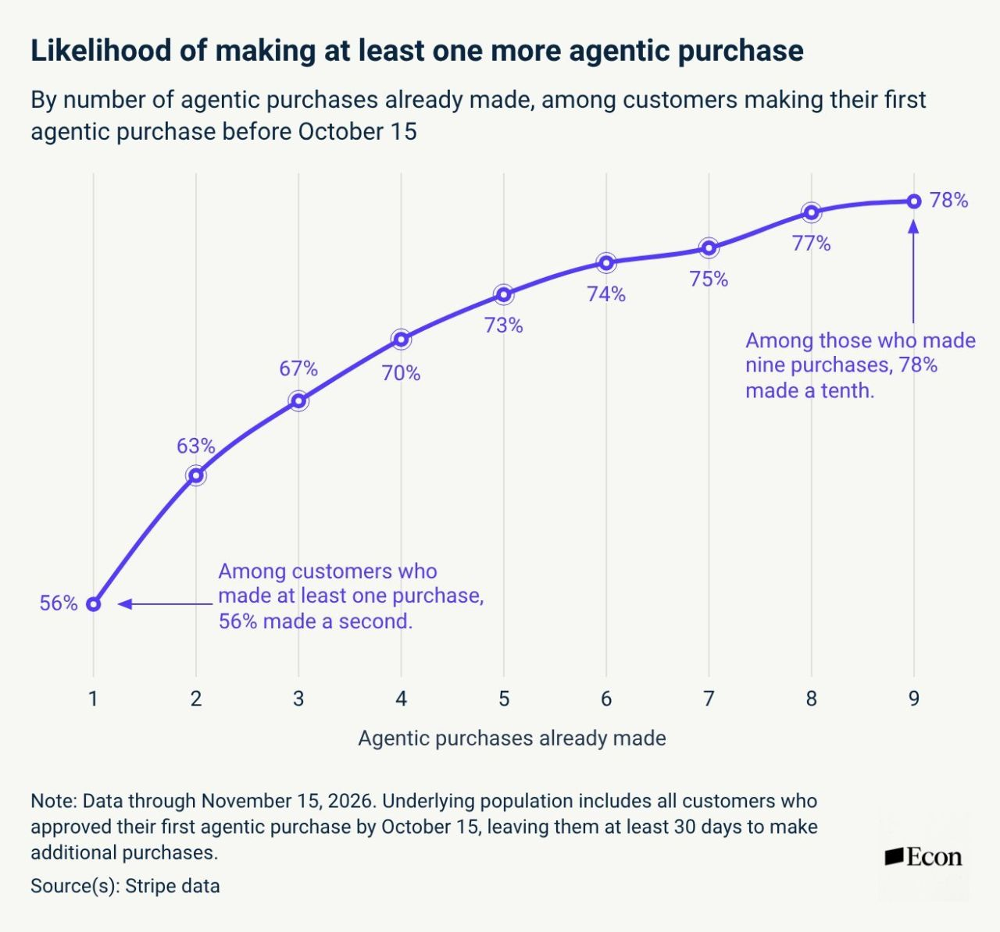

Today I saw a [fascinating dataviz (mis)interpretation case](https://lnkd.in/p/e7xdAvba) that featured a plot from a recent [Stripe data analysis](https://substack.com/@ernietedeschi/note/c-392796478) that claims that agentic commerce is on the rise and is very "sticky". 

A very compelling story, supported by a nice upward facing line... At least that's the first impression. We are apparently seeing an emerging success story for AI-driven commerce. 



Among customers who made one purchase, 56% made a second. Among those who reached nine purchases, 78% went on to make a tenth. The curve climbs steadily from 56% to 78%, subtly nudging the reader toward the impression that customer retention strengthens as people get hooked on agentic shopping.

Except...Those who ever saw markovian processes immediately spot the issue here. A very common example of such a process is is a sequence of **birth parity progression probabilities**, the metric demographers use to measure the proportion of women with a specific number children who go on to have the next one.

Plotting conditional probabilities creates a classic selection illusion because the reader (being just a human) cannot immediately see how each successive step along the probability line is shrinking the pool of the remaining people who are subject to experiencing the next transition probability. 

How can we better represent the data? One way is to turn it into a survival curve showing explicitly the process of dropping out of the initial pool. 

Let's run the numbers in R:

```{r}
#| label: survival-calc
#| message: false
#| warning: false

library(tidyverse)
library(gt)

df_survival <- tibble(
  order = 1:10,
  p_continue = c(0.56, 0.63, 0.67, 0.70, 0.73, 0.74, 0.75, 0.77, 0.78, NA)
) |>
  mutate(
    survival = lag(cumprod(p_continue), default = 1),
    drop_off = survival - lead(survival)
  )


df_survival |>
  gt::gt() |>
  gt::fmt_percent(columns = c(p_continue, survival, drop_off), decimals = 1) |>
  gt::sub_missing(missing_text = "—") |>
  gt::cols_label(
    order = "Order",
    p_continue = "Conditional P(next)",
    survival = "Cohort surviving",
    drop_off = "Drop-off"
  )
```

Already here, in the table representation of the data, we can see the main point. Of those who tried agentic shopping, half never bothered again, and so on. When you represent the progression as a survival line, only 4% of the initial pool reached 10th order.

Let's plot it:


```{r, include=FALSE}
#| label: custom-theme
devtools::source_gist("653e1040a07364ae82b1bb312501a184")
sysfonts::font_add_google("Atkinson Hyperlegible", family = "ah")
showtext::showtext_auto()
theme_set(theme_ik(base_family = "ah", base_size = 16))
```


```{r}
#| label: fig-survival
#| message: false
#| warning: false
#| fig-cap: "Cohort survival across repeat agentic purchases (recalculated from Stripe data)"
#| fig-width: 5
#| fig-height: 4

df_survival |>
  ggplot(aes(x = order, y = survival)) +
  geom_step(linewidth = 1, color = "#269292") +
  geom_point(size = 2.5, color = "#269292") +
  geom_text(
    aes(label = scales::percent(survival, accuracy = 0.1)),
    vjust = -1.1,
    hjust = -.1,
    size = 5
  ) +
  scale_x_continuous(breaks = 1:10) +
  scale_y_continuous(
    labels = scales::percent_format(accuracy = 1),
    limits = c(0, 1.08),
    expand = c(0, 0)
  ) +
  labs(
    title = "Only 4% of initial buyers\nreach a 10th agentic order",
    subtitle = "Share of first-time buyers surviving to at least the n-th purchase",
    x = "Order number (n)",
    y = "Initial cohort surviving",
    caption = "Data: Stripe analysis (Nov 2026) | Graphic: @ikashnitsky.phd"
  ) 
```

So, is the glass half filled or almost empty? 🙃

