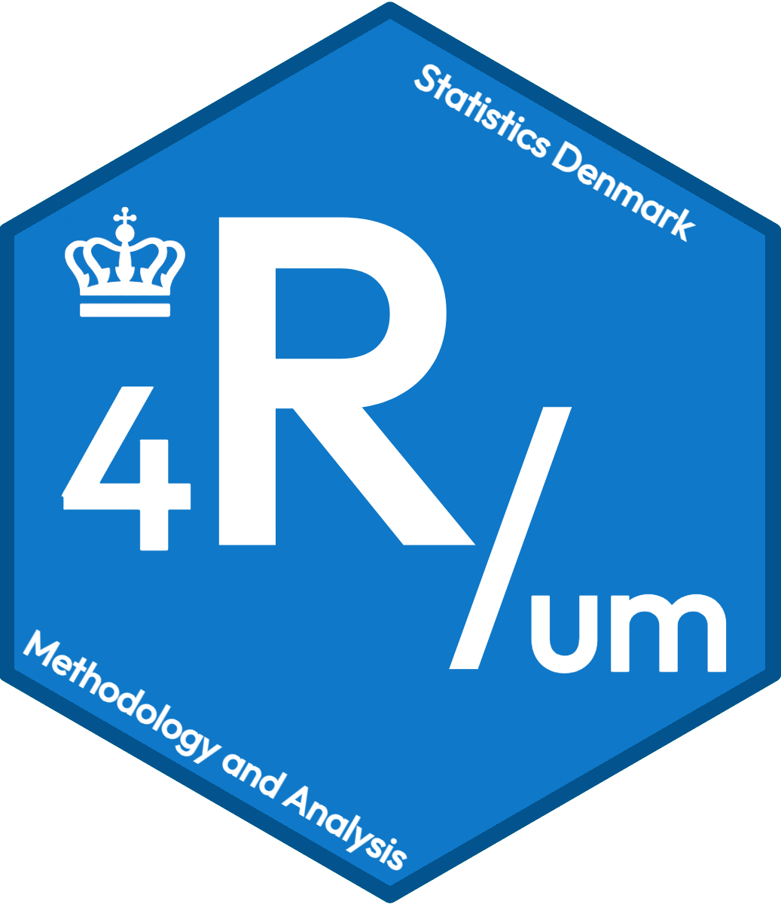
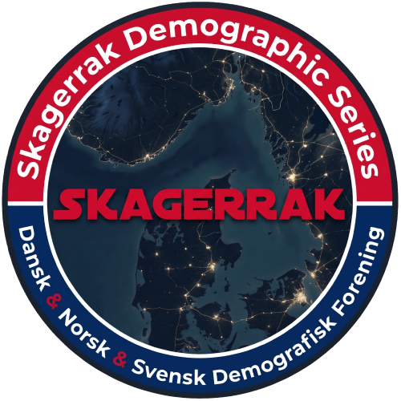

A selection of research projects, teaching initiatives, and academic columns.

::: {.row .row-cols-1 .row-cols-md-2 .g-4 .my-4}

::: {.col}
::: {.card .h-100 .shadow-sm .project-card}

  

::: {.card-body .d-flex .flex-column}

  <h3 class="card-title mt-0 mb-0"><a href="https://datavizartskill.ikashnitsky.phd" class="stretched-link text-decoration-none">Dataviz – the Art/Skill Cocktail</a></h3>
  Workshop / Course

DatavizArtSkill

An intensive, practice-oriented data visualization curriculum and workshop series. Designed to empower researchers with the flexibility of R and the tidyverse (<code>ggplot2</code>) to build impactful, publication-ready graphics, explore visual design theory, and master reproducible thematic cartography.

  Explore project &rarr;

:::
:::
:::

::: {.col}
::: {.card .h-100 .shadow-sm .project-card}

  

::: {.card-body .d-flex .flex-column}

  <h3 class="card-title mt-0 mb-0"><a href="https://dshub.dev" class="stretched-link text-decoration-none">4R/um</a></h3>
  Community / Club

Statistics Denmark R Exchange

A monthly R exchange meeting and discussion club at Statistics Denmark. Fostering open collaboration, reproducibility, and knowledge sharing around open-source data science tools, Quarto publishing, and modern R workflows.

  Explore project &rarr;

:::
:::
:::

::: {.col}
::: {.card .h-100 .shadow-sm .project-card}

  

::: {.card-body .d-flex .flex-column}

  <h3 class="card-title mt-0 mb-0"><a href="https://demografi.dk/skagerrak" class="stretched-link text-decoration-none">Skagerrak Demographic Series</a></h3>
  Seminar Series

DDF &middot; NDF &middot; SDF

A joint monthly seminar series organized by the Danish, Norwegian, and Swedish Demographic Societies. Hosted online with hybrid hubs in Copenhagen, Oslo, and Stockholm, providing a Nordic platform for knowledge exchange and discussion across the demographic community.

  Explore project &rarr;

:::
:::
:::

::: {.col}
::: {.card .h-100 .shadow-sm .project-card}

  

::: {.card-body .d-flex .flex-column}

  <h3 class="card-title mt-0 mb-0"><a href="dd.html" class="stretched-link text-decoration-none">Demographic Digest</a></h3>
  Academic Column

Демографический Дайджест

A long-running academic column at <em>Demoscope Weekly</em> featuring Russian-language summaries and critical overviews of fresh demographic research papers published in top international peer-reviewed journals.

  Read digest &rarr;

:::
:::
:::

:::
